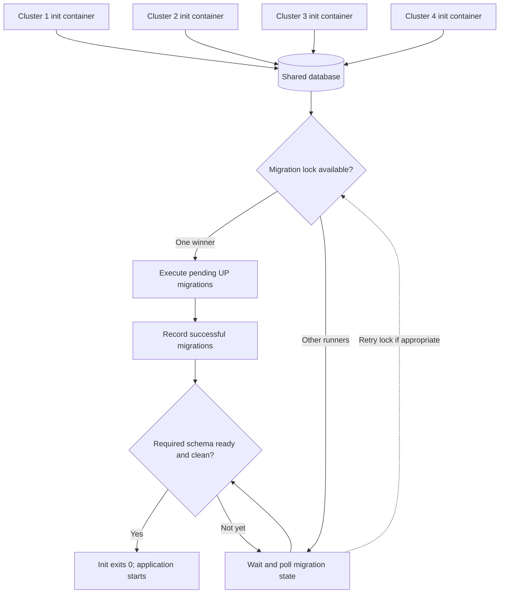
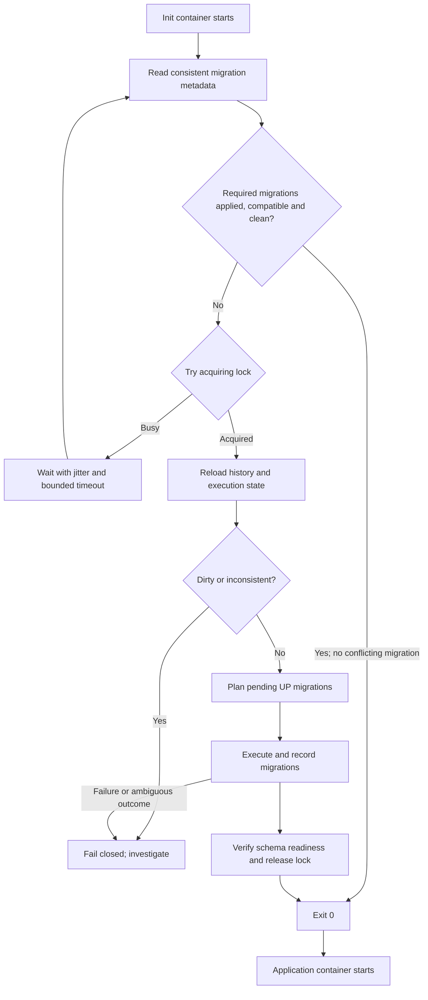
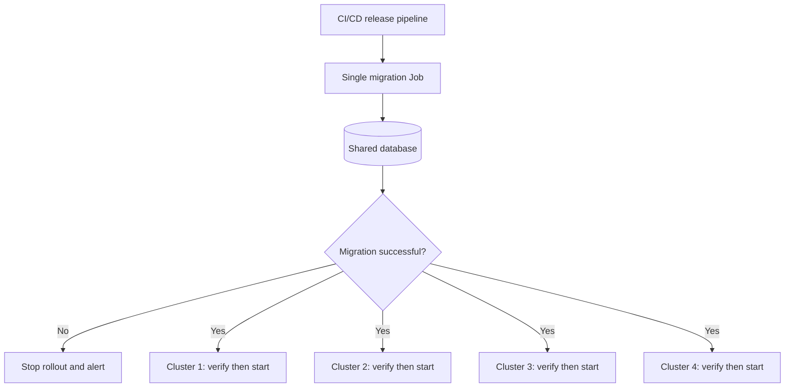

# Multi-Cluster Database Migrations

An EF-inspired, SQL-first migration engine for Kubernetes deployments sharing a PostgreSQL-compatible database.

## 1. Context and problem statement

The application is deployed across four Kubernetes clusters. Each deployment has an init container that executes SQL migration scripts against the same database. Each migration has an UP and a DOWN script. Existing scripts use `IF EXISTS` and `IF NOT EXISTS` where appropriate, but these conditions are not a concurrency control mechanism and do not track migration completion.

The database does not provide advisory locks in the environment in question. A table-based distributed lock already exists. The current problem is that init containers that cannot acquire the lock skip migration execution and proceed with application startup, even when required schema changes are still in progress.

The goal is to provide an Entity Framework-like migration experience without introducing an ORM, while guaranteeing safe migration execution and coordinated application startup across clusters.

## 2. Architecture and guarantees

Use **distributed migration locking + versioned migration history + a schema readiness gate**.

- Mutual exclusion: only one authorized migration runner modifies the shared database at a time.
- Startup safety: an init container exits successfully only after verifying its release's required migrations and a clean, compatible schema state.
- Incremental execution: previously applied scripts are not rerun during routine deployments or pod restarts.
- Explicit rollback: DOWN migrations are administrative operations, never automatically triggered by an older application image.
- Failure visibility: partially completed migrations block unsafe startup and require verified recovery.



The lock answers **who can migrate**. The history answers **what has been applied**. The readiness gate answers **whether this application may start**.

## 3. Migration files

Use timestamp-based IDs, similar to Entity Framework, or a consistently increasing integer sequence.

```text
migrations/
├── 20261120090000_initial_schema.up.sql
├── 20261120090000_initial_schema.down.sql
├── 20261121103000_create_jobs.up.sql
├── 20261121103000_create_jobs.down.sql
├── 20261122140000_add_job_status.up.sql
├── 20261122140000_add_job_status.down.sql
├── 20261124080000_create_audit.up.sql
└── 20261124080000_create_audit.down.sql
```

Rules:

- Every migration has a unique ID, a descriptive name and matching UP and DOWN scripts.
- Sort numerically by ID; do not depend on filesystem enumeration order.
- Once released, migrations are immutable. Correct mistakes using new migrations.
- Do not introduce older migration IDs into an already applied sequence without an explicit reconciliation policy.
- Validate duplicates, missing pairs, unknown history entries and checksum mismatches.
- An idempotent statement may help recovery, but it does not prove the entire script ran or that the resulting object has the expected definition.

Example:

```sql
-- 20261122140000_add_job_status.up.sql
ALTER TABLE jobs ADD COLUMN IF NOT EXISTS status VARCHAR(30);
```

```sql
-- 20261122140000_add_job_status.down.sql
ALTER TABLE jobs DROP COLUMN IF EXISTS status;
```

DOWN scripts may destroy data; their existence does not guarantee a lossless rollback.

## 4. Database metadata

Use three tables, scoped to a single migration stream for this example. If multiple applications own independent schemas, use separate metadata schemas or include a stream identifier consistently in keys and locking.

### 4.1 Migration history

Similar to `__EFMigrationsHistory`, this table records only successfully applied migrations.

```sql
CREATE TABLE IF NOT EXISTS schema_migrations (
    migration_id BIGINT PRIMARY KEY,
    migration_name VARCHAR(255) NOT NULL,
    checksum VARCHAR(64) NOT NULL,
    applied_at TIMESTAMPTZ NOT NULL DEFAULT NOW(),
    applied_by VARCHAR(255),
    execution_time_ms BIGINT
);
```

| Migration ID | Name | Applied? |
|---|---|---|
| 20261120090000 | initial_schema | Yes |
| 20261121103000 | create_jobs | Yes |
| 20261122140000 | add_job_status | Yes |
| 20261124080000 | create_audit | No |

Only `create_audit.up.sql` needs to execute in this example. Validate the complete required migration set; the highest ID alone cannot prove that there are no gaps.

### 4.2 Migration lock

Adapt this example to the existing lock implementation.

```sql
CREATE TABLE IF NOT EXISTS schema_migration_lock (
    lock_name VARCHAR(100) PRIMARY KEY,
    owner_id VARCHAR(255),
    acquired_at TIMESTAMPTZ,
    heartbeat_at TIMESTAMPTZ,
    expires_at TIMESTAMPTZ
);
```

Initialize the singleton row once:

```sql
INSERT INTO schema_migration_lock (lock_name)
VALUES ('schema_migration')
ON CONFLICT (lock_name) DO NOTHING;
```

An atomic conditional update can acquire a free lock without a read-then-write race:

```sql
UPDATE schema_migration_lock
SET owner_id = $1,
    acquired_at = NOW(),
    heartbeat_at = NOW()
WHERE lock_name = 'schema_migration'
  AND owner_id IS NULL
RETURNING owner_id;
```

Commit acquisition before starting migration work. Zero returned rows means the lock was not acquired. Treat transaction conflicts, ambiguous commit outcomes and connection errors explicitly; do not equate them with successful acquisition. Confirm database compatibility and transaction behavior through concurrent integration testing.

The owner ID should include the cluster, pod and a unique execution UUID. Heartbeats and release must be conditional on that owner ID:

```sql
UPDATE schema_migration_lock
SET heartbeat_at = NOW()
WHERE lock_name = 'schema_migration' AND owner_id = $1;
```

```sql
UPDATE schema_migration_lock
SET owner_id = NULL,
    acquired_at = NULL,
    heartbeat_at = NULL,
    expires_at = NULL
WHERE lock_name = 'schema_migration' AND owner_id = $1;
```

An expired timestamp or missing heartbeat is evidence of a suspected failure, not proof that the previous runner has stopped issuing SQL. This example deliberately does not automatically steal expired locks.

### 4.3 Migration execution state (dirty marker)

```sql
CREATE TABLE IF NOT EXISTS schema_migration_state (
    id INT PRIMARY KEY CHECK (id = 1),
    migration_id BIGINT,
    direction VARCHAR(4) CHECK (direction IN ('UP', 'DOWN')),
    dirty BOOLEAN NOT NULL DEFAULT FALSE,
    started_at TIMESTAMPTZ,
    owner_id VARCHAR(255),
    last_error TEXT
);

INSERT INTO schema_migration_state (id, dirty)
VALUES (1, FALSE)
ON CONFLICT (id) DO NOTHING;
```

This state tracks in-flight or potentially incomplete work. For non-transactional DDL, persist and commit the dirty marker before executing the migration. Never clear it on a failed or ambiguous execution merely to unblock deployment.

| History | Dirty | Meaning |
|---|---|---|
| V3 | false | Clean at version 3 |
| V3 | true | Version 4 may be running or partially applied |
| V4 | false | Version 4 successfully recorded |

Bootstrap the metadata tables and singleton rows through controlled provisioning before concurrent deployment, or implement a database-specific, concurrency-safe initialization procedure. `CREATE TABLE IF NOT EXISTS` alone is not a complete concurrent-bootstrap solution.

## 5. Init container execution flow



Use double-checking: read history before acquisition for the fast path, and reload it after obtaining the lock. Another runner may have completed the migrations in between.

Illustrative Go-style pseudocode (database helpers omitted):

```go
func InitializeDatabase(ctx context.Context, release Release) error {
    for {
        state, err := ReadMigrationSnapshot(ctx)
        if err != nil {
            return err // or bounded retry for classified transient errors
        }
        if state.ReadyFor(release) {
            return nil
        }
        acquired, err := TryAcquireLock(ctx)
        if err != nil {
            return err
        }
        if acquired {
            // Reload state under ownership, validate history, reject
            // abandoned dirty state, apply only missing UP migrations,
            // verify readiness, and release only when safe.
            return RunWithOwnedLock(ctx, release)
        }
        if err := WaitWithJitter(ctx); err != nil {
            return err
        }
    }
}
```

`ReadyFor` must validate the required migration IDs/checksums, a clean state, and compatibility with newer schemas. A conservative gate also waits for active conflicting migration work to finish. A metadata check cannot prevent a future incompatible migration from breaking an already running application; use coordinated releases and expand/contract for that.

### Example: four concurrent deployments

```mermaid
sequenceDiagram
    participant A as Cluster 1
    participant B as Cluster 2
    participant C as Cluster 3
    participant D as Cluster 4
    participant DB as Shared database
    par Concurrent startup
        A->>DB: Read history / try lock
        DB-->>A: Lock acquired
    and
        B->>DB: Read history / try lock
        DB-->>B: Busy
    and
        C->>DB: Read history / try lock
        DB-->>C: Busy
    and
        D->>DB: Read history / try lock
        DB-->>D: Busy
    end
    A->>DB: Recheck history; mark migration dirty
    A->>DB: Execute missing UP scripts
    par Wait for required schema
        B->>DB: Poll history and state
    and
        C->>DB: Poll history and state
    and
        D->>DB: Poll history and state
    end
    A->>DB: Record success; clear dirty; release lock
    A->>A: Start application
    par Verify readiness
        B->>DB: Verify schema ready
        DB-->>B: Ready
        B->>B: Start application
    and
        C->>DB: Verify schema ready
        DB-->>C: Ready
        C->>C: Start application
    and
        D->>DB: Verify schema ready
        DB-->>D: Ready
        D->>D: Start application
    end
```

A lock loser does not necessarily need to acquire the lock later: if its required migrations are already complete and the state is safe, it can exit successfully without becoming a migration executor.

## 6. UP and DOWN execution semantics

Assume migrations 001 through 003 are applied and 004 and 005 exist in the release.

| Requested operation | Execution order |
|---|---|
| UP to latest | 004 UP, 005 UP |
| UP to 004 | 004 UP |
| DOWN to 001 | 003 DOWN, 002 DOWN |
| Already at target | No work |

UP execution:

1. Acquire exclusive migration ownership and validate metadata.
2. Select missing migrations in ascending order.
3. For each migration, mark it dirty and commit the marker when using non-atomic DDL.
4. Execute its UP script and validate the outcome.
5. Insert the success history row and clear dirty state together in one metadata transaction.
6. Verify the release requirements; release the lock on a safe terminal outcome.

DOWN execution:

1. Confirm explicit administrative intent, target version, backups and application compatibility across all clusters.
2. Acquire the same exclusive lock used for UP.
3. Select applied migrations above the target in descending order.
4. Mark the current migration dirty, execute its DOWN script and verify the outcome.
5. Delete that history row and clear dirty state together in one metadata transaction.
6. Verify the target and release the lock on a safe terminal outcome.

For fully transactional DDL, the script and history update can instead share one transaction (verify support and avoid statements that cannot run in a transaction). The database can roll back both on failure. For non-transactional DDL, the marker protects against the gap between schema execution and metadata persistence, but does not automatically repair the schema.

The history table describes current applied migrations; use an append-only execution audit table or structured logs if historical DOWN attempts and failures must remain visible.

## 7. Locking strategy and crash recovery

### Persistent table lock

Recommended when advisory locks are unavailable and the database cannot guarantee that all DDL can execute in a single lock-holding transaction. Use an atomic acquire, unique owner token, conditional heartbeat/release and explicit recovery.

Illustrative settings (tune to actual migration duration and operational requirements):

| Setting | Example |
|---|---|
| Heartbeat interval | 15 seconds |
| Suspected stale threshold | 120 seconds |
| Wait polling | 5 seconds plus random jitter |
| Maximum wait per init attempt | 15 minutes |

Do not automatically take over solely because a heartbeat expires. A network partition can stop heartbeat delivery while the database is still executing a previously submitted DDL statement. A new runner would then overlap with the old one. Fencing requires enforcement at the actual mutation boundary; an owner token in the metadata table alone does not fence arbitrary SQL.

If ownership is lost or SQL outcome is ambiguous, stop issuing further statements, preserve dirty state and fail closed. Before reclaiming a stale lock, verify that the prior owner cannot resume and its database operations have terminated, then reconcile schema and history. Administrative recovery should itself be serialized and audited.

### Transaction-based row lock (alternative)

```sql
BEGIN;
SELECT lock_name
FROM schema_migration_lock
WHERE lock_name = 'schema_migration'
FOR UPDATE;
-- Protected work in the same transaction, where supported.
COMMIT;
```

A database-managed lock is released when its transaction terminates, eliminating logical lease reclamation for work protected by that same transaction. However, holding a row lock on one connection while executing DDL on another does not guarantee safety if the lock connection is lost.

For the YugabyteDB/PostgreSQL-compatible environment discussed (YugabyteDB 2024.2 series), verify transaction semantics, row-lock conflict behavior and supported DDL operations against the exact database version and configuration. Do not assume standard PostgreSQL transactional DDL or advisory lock support.

## 8. Failure handling and repair

| Scenario | Required behavior |
|---|---|
| Another runner owns the lock | Wait with jitter; recheck readiness and retry acquisition if needed |
| Required migrations already applied | Verify clean compatible state and exit 0 |
| Database unavailable | Bounded retry for transient errors; fail closed otherwise |
| Runner crashes before migration starts | Reclaim only after verifying prior owner and operations are stopped |
| SQL fails midway | Preserve dirty state; log error; block unsafe startup |
| SQL succeeds but history write fails | Treat as ambiguous; inspect actual schema and reconcile |
| Lock ownership lost | Stop further SQL; verify termination and reconcile before takeover |
| Maximum wait exceeded | Exit non-zero; Kubernetes may retry with backoff |
| Applied script checksum differs | Fail validation and investigate |
| Existing pod restarts or scales | Use readiness fast path if requirements are satisfied |

Repair must never simply mark a failed migration as successful to bypass the startup gate. Inspect database catalog and data, compare against expected postconditions, and choose an audited repair: complete missing changes, safely undo partial changes, restore from backup, or record success after proving all effects are present. Clear dirty state and reconcile metadata only after verification.

Avoid splitting SQL files naively on semicolons: quoted strings, comments and dollar-quoted procedural bodies can contain semicolons. Use a tested SQL migration executor, driver-supported script execution, or a PostgreSQL-aware parser. Explicitly define transaction behavior and stop on the first error. Never include secrets or sensitive SQL parameters in logs.

## 9. Checksum validation and compatibility

Calculate SHA-256 over the released UP script bytes and persist the result in `schema_migrations`. Use stable line endings or a documented canonicalization rule. Validate DOWN scripts against an immutable release manifest, or also persist their checksums.

Example:

```text
Migration: 003_add_job_status
Recorded checksum: a82b7c...
Current checksum:  f93d2a...
ERROR: Previously applied migration was modified.
```

For a newer database schema, verify the local required migration prefix and its checksums. Permit additional migrations only under an explicit compatibility policy. Unknown entries in the middle of the local expected history, missing IDs and incompatible newer schemas are errors.

## 10. CLI design (EF-like experience)

| Command | Behavior |
|---|---|
| `migrator up` | Apply all pending UP migrations, waiting for concurrent execution as needed |
| `migrator up --target 003` | Apply pending UP migrations through the target; never downgrade |
| `migrator down` | Explicitly revert the latest migration |
| `migrator down --target 002` | Explicitly revert migrations above target 002 |
| `migrator status` | Display current history, pending migrations, lock and dirty state |
| `migrator validate` | Validate file pairing, history and checksums |
| `migrator plan` | Display the planned operations without executing SQL |
| `migrator wait` | Read-only readiness gate for a release |
| `migrator repair` | Controlled, audited metadata repair after verification |
| `migrator create add_job_status` | Scaffold paired timestamped SQL files |

Administrative DOWN and repair operations should use restricted credentials, explicit confirmation/approval and the same locking protocol.

## 11. Kubernetes integration

Use a regular init container. Kubernetes does not start application containers until regular init containers complete successfully.

```yaml
initContainers:
  - name: db-migrator
    image: db-migrator:1.5.0
    args:
      - up
      - --lock-timeout=15m
      - --poll-interval=5s
    env:
      - name: DATABASE_URL
        valueFrom:
          secretKeyRef:
            name: migration-database
            key: connection-string
```

This is a pod-spec fragment, not a complete Deployment. Use a release-specific migration image or immutable digest. The migration runner should handle SIGTERM and context cancellation, distinguish lock contention from errors, avoid unsafe lock release, and exit non-zero on failure or timeout. Kubernetes can retry the init container; a single attempt timeout is not a global rollout timeout. Set suitable deployment progress deadlines and alerts.

## 12. Rolling releases and DOWN migrations

Never automatically execute DOWN scripts at application startup.

```text
Cluster 1: application V5 ─┐
Cluster 2: application V5 ─┤
Cluster 3: application V4 ─┼── Shared schema V5
Cluster 4: application V4 ─┘
```

If an older V4 image restarts, it must not downgrade the database simply because it contains no V5 migration files. If V5 is backward-compatible, V4 can continue; otherwise block startup and coordinate the deployment.

Use the **expand and contract** pattern:

| Phase | Operation |
|---|---|
| Expand | Introduce compatible columns/tables/indexes |
| Migrate | Deploy applications compatible with old and new schema |
| Backfill | Migrate existing data; validate results |
| Contract | Remove obsolete schema only after all older consumers are retired |

Application rollback and database rollback are separate operational decisions. Prefer forward fixes when practical, particularly for destructive changes.

## 13. Preferred longer-term architecture: dedicated migration Job

If the release pipeline can coordinate all four clusters, separate schema migration from pod startup. Run one centrally orchestrated Kubernetes Job per release and shared database, then deploy applications only after successful completion. Retain database locking for concurrent releases and read-only init-container verification.



Kubernetes Jobs may retry or create replacement pods; a Job by itself does not guarantee globally exactly-once execution. A per-cluster Kubernetes Lease also does not coordinate independent cluster control planes. Keep the shared database as the coordination authority.

Benefits: fewer concurrent migration contenders, simpler application startup, centralized audit and the ability to remove DDL permissions from application credentials. The verification init container can use read-only metadata access.

## 14. Existing migration tools

| Feature | golang-migrate | Goose | Liquibase |
|---|---|---|---|
| Raw SQL | Yes | Yes | Yes |
| Paired UP/DOWN files | Native | Usually one SQL file with annotations | External SQL files via changelog |
| Migration metadata | Current version and dirty flag (standard driver) | Version tracking | Per-changeset history |
| Checksum validation | Not built-in by default | Not built-in by default | Built-in |
| Locking | Driver-specific; PostgreSQL driver typically advisory locks | Provider/configuration dependent | Table-based lock |
| ORM required | No | No | No |

Evaluate versions and database-specific integrations before choosing a tool. In particular, do not assume the default PostgreSQL locking strategy works in an environment without advisory locks.

Liquibase is worth evaluating because it maintains `DATABASECHANGELOG` and `DATABASECHANGELOGLOCK` and supports external SQL files with explicit rollback scripts:

```yaml
databaseChangeLog:
  - changeSet:
      id: 20261124080000
      author: development-team
      changes:
        - sqlFile:
            path: migrations/20261124080000_create_audit.up.sql
            relativeToChangelogFile: true
      rollback:
        - sqlFile:
            path: migrations/20261124080000_create_audit.down.sql
            relativeToChangelogFile: true
```

Validate its YugabyteDB integration, lock recovery, checksum, SQL parsing and non-transactional DDL failure behavior. Table-based locking does not remove the need for a safe recovery policy.

## 15. Suggested Go implementation layout

```text
db-migrator/
├── cmd/migrator/main.go
├── internal/
│   ├── migration/
│   │   ├── engine.go
│   │   ├── discovery.go
│   │   ├── planner.go
│   │   └── checksum.go
│   ├── database/
│   │   ├── history.go
│   │   ├── state.go
│   │   └── lock.go
│   └── executor/
│       ├── up.go
│       └── down.go
├── migrations/
│   ├── embed.go
│   ├── 001_initial.up.sql
│   ├── 001_initial.down.sql
│   ├── 002_jobs.up.sql
│   └── 002_jobs.down.sql
├── Dockerfile
└── go.mod
```

Embed migration scripts into the executable for a self-contained release artifact. In `migrations/embed.go`:

```go
package migrations

import "embed"

//go:embed *.sql
var Files embed.FS
```

Keep discovery, planning, locking, execution and history persistence separately testable. Use structured logs with cluster, pod, owner ID, migration ID, direction, duration and outcome. Expose metrics for pending migrations, lock wait, dirty state and migration failures where practical.

### Integration test checklist

- [ ] Forty concurrent runners (four clusters, ten pods each): only one executes each migration in the normal success path.
- [ ] Lock loser never exits successfully before required migrations complete.
- [ ] Restart after successful migration does not rerun the script.
- [ ] Runner terminated before, during and after SQL execution; include history-write failure.
- [ ] Network partition or lost heartbeat during long-running DDL does not permit unsafe takeover.
- [ ] Ambiguous lock-acquisition or release commit; verify ownership safely.
- [ ] Dirty marker prevents further migrations and unsafe startup; repair requires verification.
- [ ] Missing migration, duplicate ID, checksum mismatch and out-of-order history are detected.
- [ ] Old and new application versions coexist without automatic downgrade.
- [ ] Explicit DOWN follows descending order; rollback failure preserves dirty state.
- [ ] Database outage, lock wait timeout and graceful termination fail safely.
- [ ] Test against the exact PostgreSQL-compatible database version, including DDL semantics.

## 16. Decision summary

| Approach | Multi-cluster coordination | Startup gate | Recommendation |
|---|---|---|---|
| Try lock and skip | Yes | No | Avoid |
| Lock and fixed sleep | Yes | No | Avoid |
| Kubernetes Lease per cluster | No global coordination | Not inherent | Insufficient alone |
| Designated primary cluster | Requires coordination | Must be added | Possible |
| Table lock + history + readiness gate | Yes | Yes | Recommended now |
| Central migration Job + shared lock + readiness verification | Yes | Yes | Preferred when pipeline supports it |

Start with the existing table-based lock and implement versioned history, paired script discovery, dirty-state tracking and startup waiting. Evaluate Liquibase before committing to a custom engine; if a lightweight Go binary and exact control over YugabyteDB behavior are priorities, a small dedicated SQL-first runner is a reasonable option.

## Further reading

- [Kubernetes init containers](https://kubernetes.io/docs/concepts/workloads/pods/init-containers/)
- [Kubernetes Jobs](https://kubernetes.io/docs/concepts/workloads/controllers/job/)
- [EF Core migrations overview](https://learn.microsoft.com/en-us/ef/core/managing-schemas/migrations/)
- [PostgreSQL explicit locking](https://www.postgresql.org/docs/current/explicit-locking.html)
- [YugabyteDB documentation](https://docs.yugabyte.com/)
- [golang-migrate](https://github.com/golang-migrate/migrate)
- [Goose](https://github.com/pressly/goose)
- [Liquibase documentation](https://docs.liquibase.com/)

The SQL and Go examples are design illustrations, not a production-tested implementation. Validate database-specific behavior before rollout.
