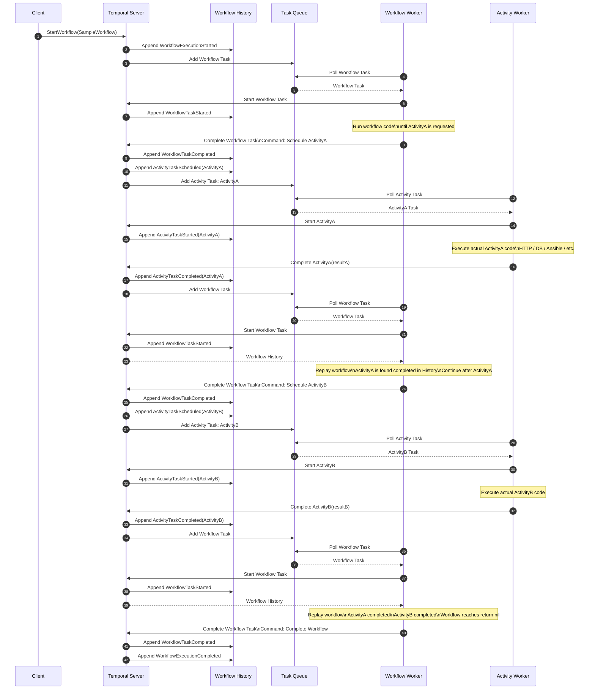

# Temporal Workflow Execution — Sequence Diagram

This document shows how a simple Temporal Workflow with **two Activities** is executed across:

- Client
- Temporal Server
- Task Queue
- Workflow Worker
- Activity Worker
- Workflow History

> In many applications, the same Worker process runs both Workflow and Activity workers. They are shown separately here only to make the interaction easier to understand.

---

## Example Workflow

```go
func SampleWorkflow(ctx workflow.Context) error {
    err := workflow.ExecuteActivity(ctx, ActivityA).Get(ctx, nil)
    if err != nil {
        return err
    }

    err = workflow.ExecuteActivity(ctx, ActivityB).Get(ctx, nil)
    if err != nil {
        return err
    }

    return nil
}
```

Logical application flow:

```text
Workflow starts
      |
      v
  Activity A
      |
      v
  Activity B
      |
      v
Workflow completes
```

---

# Sequence Diagram



---

# What Each Component Does

## Temporal Server

The Temporal Server owns the durable orchestration state.

It is responsible for things such as:

- receiving workflow start requests
- persisting Workflow History
- scheduling Workflow Tasks
- scheduling Activity Tasks
- tracking Activity retries and timeouts
- managing timers
- accepting Activity completion results
- scheduling another Workflow Task when new events arrive

The Server **does not execute your Workflow or Activity code**.

---

## Task Queue

A Task Queue is the routing mechanism between the Temporal Server and Workers.

It can contain work such as:

```text
Workflow Task
Activity Task
```

Workers continuously poll a configured Task Queue.

```text
Temporal Server
      |
      v
   Task Queue
      |
      v
    Worker
```

A Task Queue does not contain your entire Workflow state. Durable Workflow state comes from the Workflow History stored by Temporal.

---

## Workflow Worker

The Workflow Worker executes Workflow code.

For example:

```go
workflow.ExecuteActivity(ctx, ActivityA)
```

The Workflow Worker does **not** directly execute `ActivityA`.

Instead, executing that line causes the SDK to generate a command similar to:

```text
ScheduleActivity(ActivityA)
```

The Worker sends that command to the Temporal Server.

So the Workflow Worker answers:

> What should happen next?

---

## Activity Worker

The Activity Worker executes the actual Activity implementation.

For example:

```go
func ActivityA(ctx context.Context) error {
    // HTTP call
    // database operation
    // Ansible call
    // filesystem operation
    return nil
}
```

Unlike Workflow code, Activities are where normal external I/O usually happens.

---

## Workflow History

Workflow History is the durable event log for a Workflow Execution.

For this example, it will look roughly like:

```text
WorkflowExecutionStarted

WorkflowTaskScheduled
WorkflowTaskStarted
WorkflowTaskCompleted

ActivityTaskScheduled: ActivityA
ActivityTaskStarted: ActivityA
ActivityTaskCompleted: ActivityA

WorkflowTaskScheduled
WorkflowTaskStarted
WorkflowTaskCompleted

ActivityTaskScheduled: ActivityB
ActivityTaskStarted: ActivityB
ActivityTaskCompleted: ActivityB

WorkflowTaskScheduled
WorkflowTaskStarted
WorkflowTaskCompleted

WorkflowExecutionCompleted
```

The History allows another Worker to reconstruct the Workflow state even if the previous Worker disappears.

---

# Important Detail: Why Another Workflow Task Is Created

After `ActivityA` completes, the Temporal Server does **not** know that `ActivityB` should run next.

The Server does not understand your business logic.

Instead:

```text
ActivityA completes
       |
       v
Temporal Server records completion
       |
       v
Server schedules Workflow Task
       |
       v
Workflow Worker runs/replays workflow
       |
       v
Workflow code reaches ActivityB
       |
       v
Worker sends ScheduleActivity(ActivityB)
       |
       v
Server schedules ActivityB Task
```

This separation is fundamental to Temporal.

---

# Commands vs Events

A useful way to understand the communication is:

```text
Worker                         Temporal Server
  |                                  |
  |------ Command ------------------->|
  |                                  |
  |                           Persist Event
  |                                  |
```

For example:

```text
Worker command:
    ScheduleActivity(ActivityA)

Temporal History event:
    ActivityTaskScheduled(ActivityA)
```

Later:

```text
Activity Worker result:
    ActivityA completed

Temporal History event:
    ActivityTaskCompleted(ActivityA)
```

---

# Simplified End-to-End Flow

```text
                         TEMPORAL SERVER
                +-----------------------------+
                |                             |
                |       Workflow History      |
                |                             |
                +-------------+---------------+
                              |
                              |
                     schedules Tasks
                              |
                              v
                     +----------------+
                     |   Task Queue   |
                     +--------+-------+
                              |
                 +------------+------------+
                 |                         |
                 v                         v
        +----------------+       +----------------+
        | Workflow Worker|       | Activity Worker|
        +----------------+       +----------------+
                 |                         |
          runs workflow             runs actual I/O
                 |                         |
                 | Commands                | Results
                 +------------+------------+
                              |
                              v
                       Temporal Server
```

---

# The Core Execution Loop

The entire system can be reduced to this repeating loop:

```text
Event occurs
    |
    v
Temporal Server records Event
    |
    v
Server creates Workflow Task
    |
    v
Workflow Worker polls Task Queue
    |
    v
Worker runs/replays Workflow code
    |
    v
Worker produces Commands
    |
    v
Temporal Server persists resulting Events
    |
    v
Server schedules Activity / Timer / Child Workflow / etc.
    |
    v
Something completes
    |
    +-----------------------------> repeat
```

The most useful mental model is:

> **Temporal Server remembers what happened. The Workflow Worker decides what should happen next. The Activity Worker performs the actual external work.**

