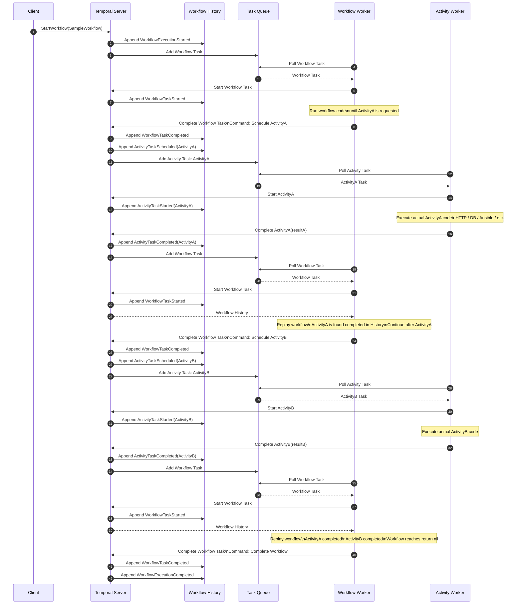
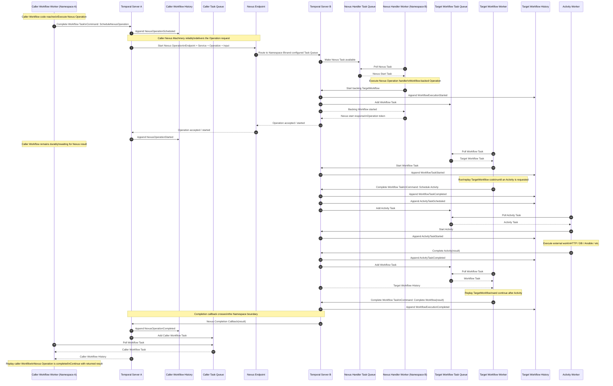
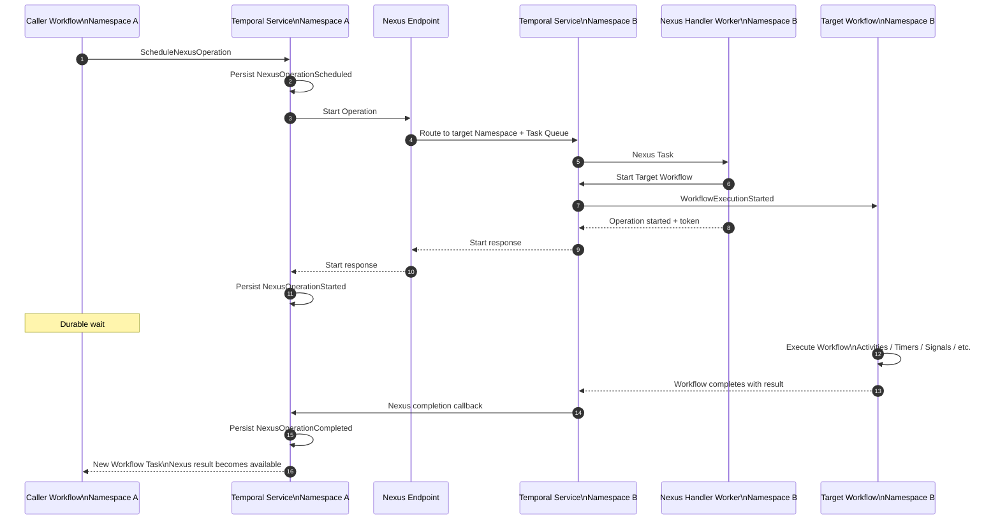
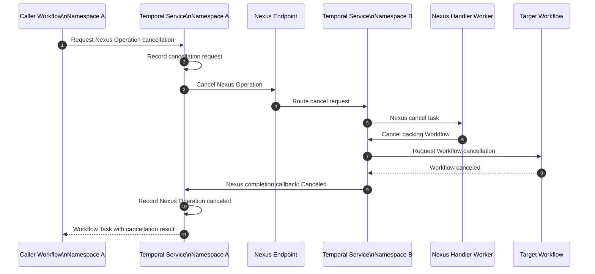

# Temporal Workflow Execution — Sequence Diagram

This document shows how a simple Temporal Workflow with **two Activities** is executed across:

- Client
- Temporal Server
- Task Queue
- Workflow Worker
- Activity Worker
- Workflow History

> In many applications, the same Worker process runs both Workflow and Activity workers. They are shown separately here only to make the interaction easier to understand.

---

## Example Workflow

```go
func SampleWorkflow(ctx workflow.Context) error {
    err := workflow.ExecuteActivity(ctx, ActivityA).Get(ctx, nil)
    if err != nil {
        return err
    }

    err = workflow.ExecuteActivity(ctx, ActivityB).Get(ctx, nil)
    if err != nil {
        return err
    }

    return nil
}
```

Logical application flow:

```text
Workflow starts
      |
      v
  Activity A
      |
      v
  Activity B
      |
      v
Workflow completes
```

---

# Sequence Diagram



---

# What Each Component Does

## Temporal Server

The Temporal Server owns the durable orchestration state.

It is responsible for things such as:

- receiving workflow start requests
- persisting Workflow History
- scheduling Workflow Tasks
- scheduling Activity Tasks
- tracking Activity retries and timeouts
- managing timers
- accepting Activity completion results
- scheduling another Workflow Task when new events arrive

The Server **does not execute your Workflow or Activity code**.

---

## Task Queue

A Task Queue is the routing mechanism between the Temporal Server and Workers.

It can contain work such as:

```text
Workflow Task
Activity Task
```

Workers continuously poll a configured Task Queue.

```text
Temporal Server
      |
      v
   Task Queue
      |
      v
    Worker
```

A Task Queue does not contain your entire Workflow state. Durable Workflow state comes from the Workflow History stored by Temporal.

---

## Workflow Worker

The Workflow Worker executes Workflow code.

For example:

```go
workflow.ExecuteActivity(ctx, ActivityA)
```

The Workflow Worker does **not** directly execute `ActivityA`.

Instead, executing that line causes the SDK to generate a command similar to:

```text
ScheduleActivity(ActivityA)
```

The Worker sends that command to the Temporal Server.

So the Workflow Worker answers:

> What should happen next?

---

## Activity Worker

The Activity Worker executes the actual Activity implementation.

For example:

```go
func ActivityA(ctx context.Context) error {
    // HTTP call
    // database operation
    // Ansible call
    // filesystem operation
    return nil
}
```

Unlike Workflow code, Activities are where normal external I/O usually happens.

---

## Workflow History

Workflow History is the durable event log for a Workflow Execution.

For this example, it will look roughly like:

```text
WorkflowExecutionStarted

WorkflowTaskScheduled
WorkflowTaskStarted
WorkflowTaskCompleted

ActivityTaskScheduled: ActivityA
ActivityTaskStarted: ActivityA
ActivityTaskCompleted: ActivityA

WorkflowTaskScheduled
WorkflowTaskStarted
WorkflowTaskCompleted

ActivityTaskScheduled: ActivityB
ActivityTaskStarted: ActivityB
ActivityTaskCompleted: ActivityB

WorkflowTaskScheduled
WorkflowTaskStarted
WorkflowTaskCompleted

WorkflowExecutionCompleted
```

The History allows another Worker to reconstruct the Workflow state even if the previous Worker disappears.

---

# Important Detail: Why Another Workflow Task Is Created

After `ActivityA` completes, the Temporal Server does **not** know that `ActivityB` should run next.

The Server does not understand your business logic.

Instead:

```text
ActivityA completes
       |
       v
Temporal Server records completion
       |
       v
Server schedules Workflow Task
       |
       v
Workflow Worker runs/replays workflow
       |
       v
Workflow code reaches ActivityB
       |
       v
Worker sends ScheduleActivity(ActivityB)
       |
       v
Server schedules ActivityB Task
```

This separation is fundamental to Temporal.

---

# Commands vs Events

A useful way to understand the communication is:

```text
Worker                         Temporal Server
  |                                  |
  |------ Command ------------------->|
  |                                  |
  |                           Persist Event
  |                                  |
```

For example:

```text
Worker command:
    ScheduleActivity(ActivityA)

Temporal History event:
    ActivityTaskScheduled(ActivityA)
```

Later:

```text
Activity Worker result:
    ActivityA completed

Temporal History event:
    ActivityTaskCompleted(ActivityA)
```

---

# Simplified End-to-End Flow

```text
                         TEMPORAL SERVER
                +-----------------------------+
                |                             |
                |       Workflow History      |
                |                             |
                +-------------+---------------+
                              |
                              |
                     schedules Tasks
                              |
                              v
                     +----------------+
                     |   Task Queue   |
                     +--------+-------+
                              |
                 +------------+------------+
                 |                         |
                 v                         v
        +----------------+       +----------------+
        | Workflow Worker|       | Activity Worker|
        +----------------+       +----------------+
                 |                         |
          runs workflow             runs actual I/O
                 |                         |
                 | Commands                | Results
                 +------------+------------+
                              |
                              v
                       Temporal Server
```

---

# Cross-Namespace Workflow Invocation Using Temporal Nexus

The previous sections show a Workflow and its Activities executing inside one Temporal Namespace.

Nexus adds a durable service boundary between Temporal applications. A common pattern is:

```text
Namespace A                                      Namespace B
Caller Workflow                                 Handler Workflow
      |                                               ^
      | Execute Nexus Operation                       |
      v                                               |
 Nexus Endpoint -------------------------------> Nexus Handler
                                                      |
                                                      | starts
                                                      v
                                               Target Workflow
```

For a Workflow-backed Nexus Operation, the Operation is **asynchronous**. The Nexus handler starts a backing Workflow in the handler Namespace, returns an Operation token/start response, and the result is delivered back to the caller when that backing Workflow completes.

The important distinction is:

> **The caller Workflow does not directly start the Workflow in the other Namespace. It schedules a Nexus Operation. The Nexus Endpoint routes that request to a Nexus handler, and the handler starts the backing Workflow.**

---

## Components Involved

For the diagrams below, assume:

```text
Namespace A = Caller Namespace
Namespace B = Handler / Service Namespace
```

The important components are:

```text
Namespace A
  Caller Workflow
  Caller Workflow Worker
  Caller Task Queue
  Caller Workflow History
  Caller Nexus Machinery

                 |
                 v

           Nexus Endpoint

                 |
                 v

Namespace B
  Nexus Handler Task Queue
  Nexus Handler Worker
  Target Workflow Task Queue
  Target Workflow Worker
  Activity Worker
  Target Workflow History
```

A Nexus Endpoint is configured to route requests to a specific **Namespace + Task Queue**. The caller addresses the Endpoint by name; it does not need to know the target Namespace or Task Queue.

---

# Nexus Sequence Diagram — Workflow in Namespace A Calls Workflow in Namespace B

The following is the full lifecycle of an asynchronous, Workflow-backed Nexus Operation.



---

# Nexus Sequence Diagram — Focus on the Namespace Boundary

The same flow can be reduced to the following sequence:



The Nexus Endpoint is therefore not another Workflow Worker. It is the routing/service boundary that maps the public Endpoint to the handler's Namespace and Task Queue.

---

# What Is Stored in Each Namespace

A cross-Namespace Nexus call does **not** create one combined Workflow History.

There are two separate durable histories.

## Namespace A — Caller Workflow History

The caller history contains events similar to:

```text
WorkflowExecutionStarted

WorkflowTaskScheduled
WorkflowTaskStarted
WorkflowTaskCompleted

NexusOperationScheduled
NexusOperationStarted

... caller Workflow waits durably ...

NexusOperationCompleted

WorkflowTaskScheduled
WorkflowTaskStarted
WorkflowTaskCompleted

WorkflowExecutionCompleted
```

The caller sees the Nexus Operation as a durable operation. It does not receive all of the internal Workflow and Activity events from Namespace B.

---

## Namespace B — Target Workflow History

The Workflow started by the Nexus handler has its own normal Workflow History:

```text
WorkflowExecutionStarted

WorkflowTaskScheduled
WorkflowTaskStarted
WorkflowTaskCompleted

ActivityTaskScheduled
ActivityTaskStarted
ActivityTaskCompleted

WorkflowTaskScheduled
WorkflowTaskStarted
WorkflowTaskCompleted

WorkflowExecutionCompleted
```

From the perspective of the Workflow in Namespace B, execution after it has been started is ordinary Temporal Workflow execution.

---

# How the Result Gets Back to the Caller

One of the most important Nexus concepts is that the caller does **not** poll the target Workflow for completion.

The flow is:

```text
Target Workflow completes in Namespace B
              |
              v
Temporal records Workflow completion
              |
              v
Nexus completion callback is delivered
              |
              v
Namespace A records NexusOperationCompleted
              |
              v
Temporal schedules a Workflow Task for caller
              |
              v
Caller Workflow Worker replays caller history
              |
              v
Execute Nexus Operation returns the result
              |
              v
Caller Workflow continues
```

This keeps the caller durable even if:

- the caller Worker restarts
- the handler Worker restarts
- the target Workflow runs for a long time
- the two applications are deployed independently

---

# What the Caller Knows vs What Nexus Hides

The caller normally works with a logical service contract:

```text
Nexus Endpoint
    +
Nexus Service
    +
Nexus Operation
```

For example:

```text
Endpoint: infrastructure-services
Service:  PatchService
Operation: PatchServers
```

The caller does not need to know that the implementation is currently:

```text
Namespace: infrastructure-prod
Task Queue: patch-handler-queue
Workflow:   PatchServersWorkflow
```

The service owner can change the implementation behind the Operation without changing the caller's Workflow contract.

---

# Nexus Handler vs Target Workflow Worker

These are different responsibilities even if the same Worker process happens to host both.

```text
Nexus Handler Worker
        |
        | receives Nexus Task
        | validates / maps request
        | starts backing Workflow
        v
Target Workflow Worker
        |
        | receives Workflow Tasks
        | runs/replays Workflow code
        | emits Commands
        v
Temporal Server
```

The Nexus handler is responsible for handling the **Operation invocation**.

The Workflow Worker is responsible for executing the **backing Workflow logic**.

---

# Nexus Operation Events vs Target Workflow Events

A useful mental model is:

```text
Namespace A / Caller History

NexusOperationScheduled
        |
        v
NexusOperationStarted
        |
        v
NexusOperationCompleted
```

while independently:

```text
Namespace B / Target Workflow History

WorkflowExecutionStarted
        |
        v
WorkflowTask...
        |
        v
ActivityTask...
        |
        v
WorkflowExecutionCompleted
```

The two executions are related through Nexus, but they remain separate durable executions.

Modern Nexus tooling can expose links between caller and handler executions for navigation and observability, but the histories themselves remain separate.

---

# Retry and Idempotency Detail

Nexus delivery is designed for reliable, **at-least-once** execution of an Operation request.

That means a Nexus handler can potentially receive a retried start request if delivery fails or a retryable error occurs.

Therefore:

> **Nexus Operation handlers should be idempotent.**

Workflow-backed Nexus helpers use Workflow identity/deduplication mechanisms so that a retried Nexus start does not normally create a brand-new backing Workflow each time.

This is conceptually similar to why Activities should also be designed with retries in mind.

---

# Cancellation Across Namespaces

Cancellation is also propagated through Nexus.

A simplified flow is:



This is different from **terminating** the caller Workflow. Cancellation is designed to propagate to a pending Nexus Operation, whereas termination can leave the handler-side execution running.

---

# Cross-Namespace Nexus Mental Model

The most useful way to remember the entire flow is:

```text
CALLER NAMESPACE

Caller Workflow
      |
      | ScheduleNexusOperation
      v
Caller Temporal Service
      |
      | durable Nexus delivery
      v

================ NEXUS BOUNDARY ================

      Nexus Endpoint
             |
             | routes to Namespace + Task Queue
             v

HANDLER NAMESPACE

Nexus Handler Worker
      |
      | starts backing Workflow
      v
Target Workflow
      |
      | normal Temporal execution
      v
Activities / Timers / Child Workflows / etc.
      |
      v
Target Workflow completes
      |
      | completion callback
      v

================ NEXUS BOUNDARY ================

Caller Temporal Service
      |
      | NexusOperationCompleted
      v
Caller Workflow Task
      |
      v
Caller Workflow resumes
```

The compact mental model is:

> **The caller Workflow schedules a Nexus Operation, Nexus routes it across the Namespace boundary, the handler starts the backing Workflow, and a completion callback wakes the caller when that Workflow finishes.**

---

# The Core Execution Loop

The entire system can be reduced to this repeating loop:

```text
Event occurs
    |
    v
Temporal Server records Event
    |
    v
Server creates Workflow Task
    |
    v
Workflow Worker polls Task Queue
    |
    v
Worker runs/replays Workflow code
    |
    v
Worker produces Commands
    |
    v
Temporal Server persists resulting Events
    |
    v
Server schedules Activity / Timer / Child Workflow / Nexus Operation / etc.
    |
    v
Something completes
    |
    +-----------------------------> repeat
```

The most useful mental model is:

> **Temporal Server remembers what happened. The Workflow Worker decides what should happen next. The Activity Worker performs the actual external work.**

